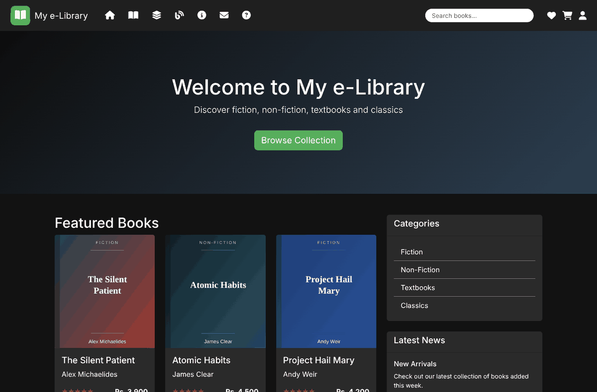
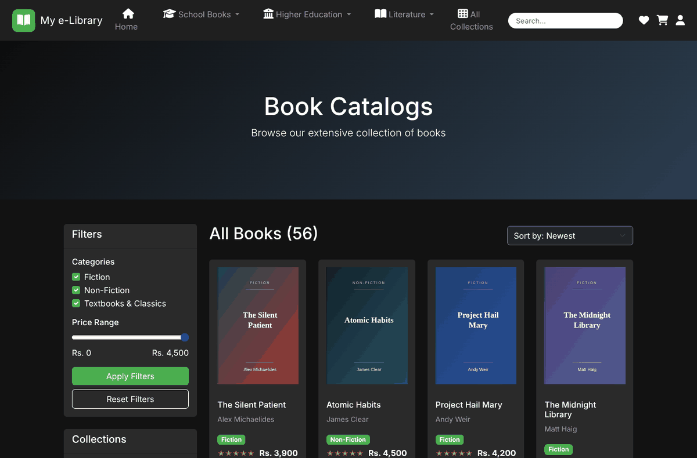
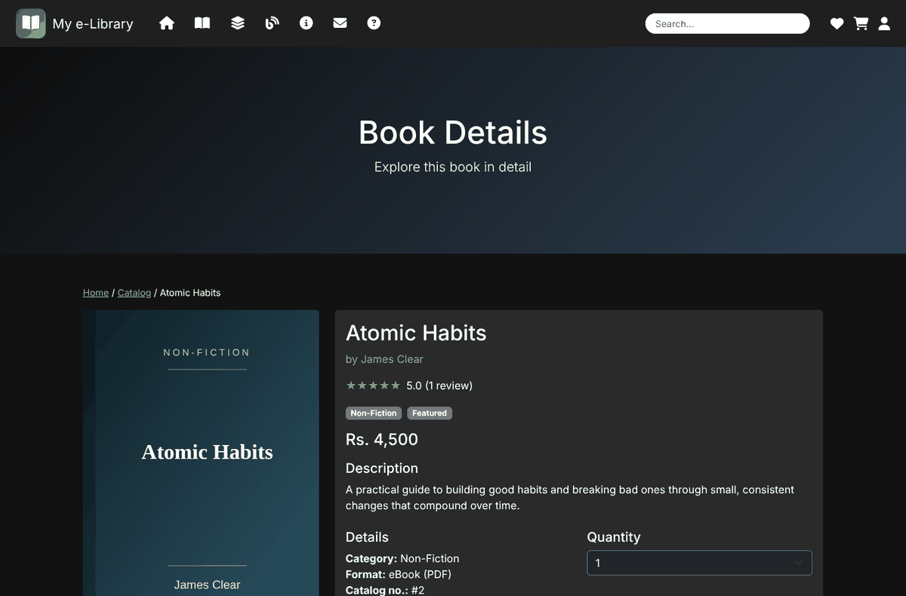
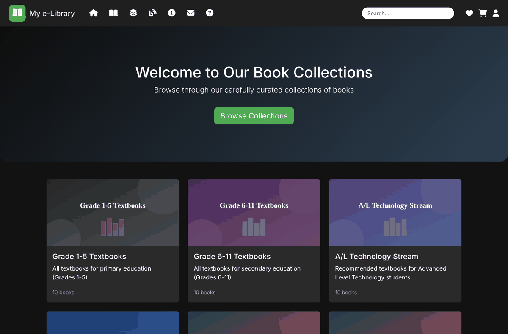
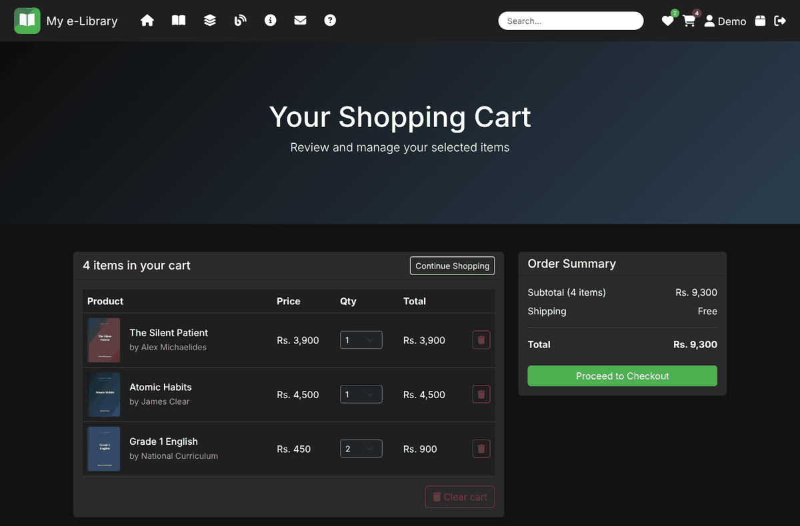
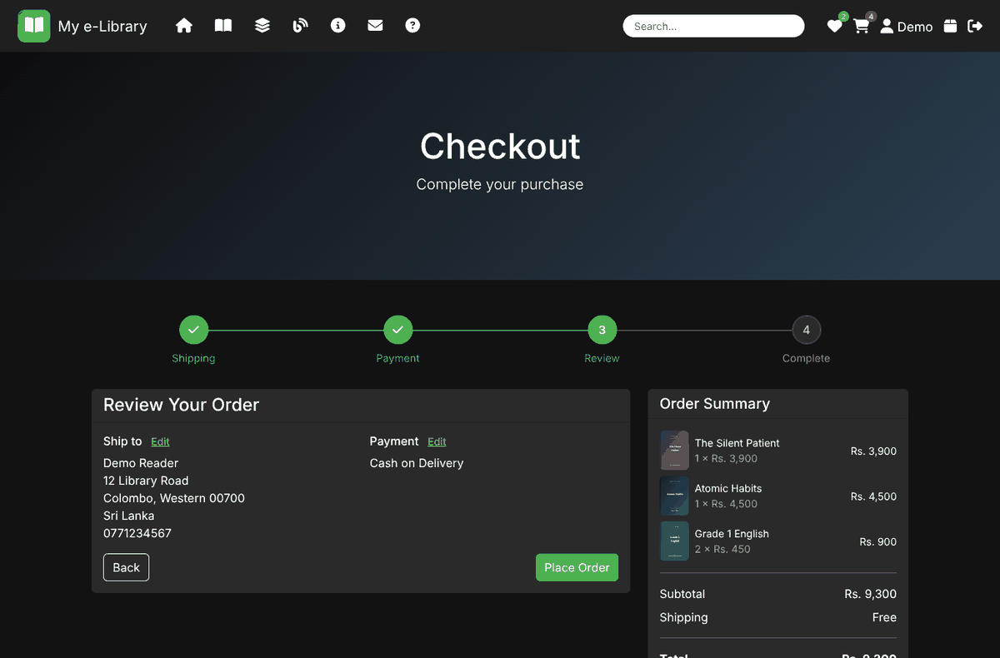
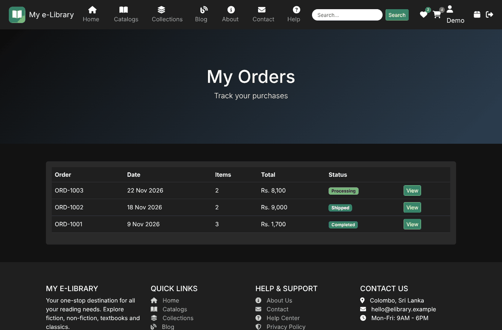
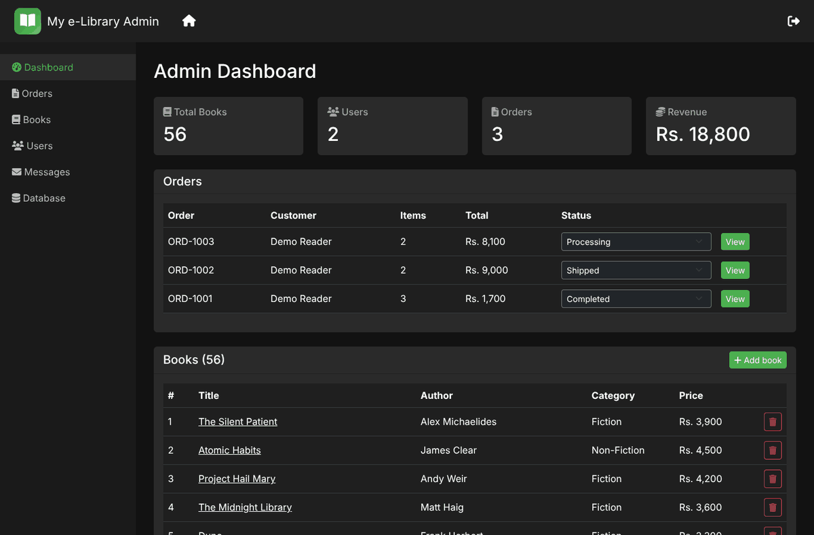
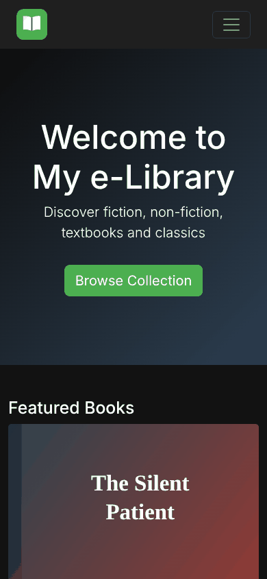

# 📚 My e-Library

[](https://github.com/<your-username>/<repo-name>/actions)


A responsive, dark-themed **online bookstore and e-library** that runs entirely in the browser. It has a complete shopping flow (register, login, catalogue, cart, wishlist, checkout, orders, reviews) and an **admin dashboard**, all backed by a **local database built on the browser's `localStorage`**, so it needs no server and can be hosted for free on GitHub Pages.

**🔗 Live demo:** `https://<your-username>.github.io/<repo-name>/`

| Home | Catalogue |
| :---: | :---: |
|  |  |

<details>
<summary>More screenshots</summary>

| Book details | Collections |
| :---: | :---: |
|  |  |
| **Cart** | **Checkout** |
|  |  |
| **Orders** | **Admin dashboard** |
|  |  |



</details>

## ✨ Features

**Readers**
- Registration and login (passwords are hashed with SHA-256 before they are stored)
- Catalogue of **56 books** (Fiction, Non-Fiction, Textbooks, Classics) with category filters, price slider, search, sorting and pagination
- Book pages with ratings, **user reviews** and related books
- Cart with quantity updates and shipping rules (free over Rs. 5,000)
- Wishlist; a guest cart and wishlist are merged into the account on login
- 4-step checkout (shipping → payment → review → confirmation) with order totals **recalculated from stored prices**
- Order history and detail pages, cancel while *Processing*, print view
- Sample PDF textbooks that can be read online or downloaded

**Admins**
- Dashboard with live totals for books, users, orders and revenue
- Change order status, add and delete books, remove users, read contact messages
- **Database tools:** export a JSON backup, import it back, or reset to demo data

**Quality**
- Responsive layout (desktop, tablet, phone), no external CDNs or image hotlinks (Bootstrap and Font Awesome are bundled in `vendor/`, book covers are generated SVGs)
- Output is HTML-escaped to prevent script injection from user-entered text
- 46 automated end-to-end checks run on every push with GitHub Actions

## 🔑 Demo Accounts

| Role   | Email                | Password     |
| ------ | -------------------- | ------------ |
| Admin  | `admin@elibrary.com` | `Admin@123`  |
| Reader | `reader@example.com` | `Reader@123` |

## 🛠️ Tech Stack

HTML5 · CSS3 · JavaScript (ES5-compatible, no build step) · Bootstrap 5.3 · Font Awesome 6 · `localStorage` · Node.js + jsdom for tests · GitHub Actions

## 🗄️ How the "Local Database" Works

`js/app.js` exposes a `Store` object that acts as a small data layer. Pages call it (`Store.addToCart(id)`, `Store.placeOrder(...)`) and it reads and writes JSON in `localStorage`.

| "Table"  | Storage key         | Notes                                           |
| -------- | ------------------- | ----------------------------------------------- |
| books    | `elib.books`        | Seeded from `js/seed-books.js` on first visit   |
| users    | `elib.users`        | Hashed passwords, roles (`user` / `admin`)      |
| orders   | `elib.orders`       | Totals recalculated from book prices            |
| cart     | `elib.cart:<email>` | One per user, plus a guest cart                 |
| wishlist | `elib.wish:<email>` | One per user, plus a guest wishlist             |
| reviews  | `elib.reviews`      | Grouped by book id                              |
| messages | `elib.messages`     | Contact form submissions                        |

Open DevTools → *Application* → *Local Storage* to inspect it.

## 🚀 Run Locally

```bash
git clone https://github.com/<your-username>/<repo-name>.git
cd <repo-name>
```
Open `index.html` in a browser, or serve the folder (e.g. VS Code *Live Server*, or `npm start`).

Run the tests:
```bash
npm install
npm test
```

## 🌐 Deploy on GitHub Pages

*Settings → Pages → Source: Deploy from a branch → `main` / root → Save.*
Then put your GitHub and LinkedIn links in `js/config.js` so the footer icons point to your profiles.

## 📁 Project Structure

```
├── index.html, catalogs.html, book-collection.html, book-details.html
├── cart.html, wishlist.html, checkout.html, order.html
├── login.html, register.html, admin.html
├── about.html, blog.html, contact.html, help.html, privacy-policy.html, terms.html
├── js/
│   ├── app.js            # local database (Store) + page logic
│   ├── seed-books.js     # initial catalogue
│   └── config.js         # your GitHub / LinkedIn links
├── vendor/               # Bootstrap + Font Awesome (bundled)
├── images/logo.svg
├── tests/                # end-to-end + unit checks (jsdom)
├── docs/screenshots/
└── backend-draft/        # early PHP + MySQL draft (not used by the site)
```

## ⚠️ Limitations

- Data is stored **only in the visitor's browser**; every browser or device has its own database.
- Client-side storage is not secure. This is a learning project: **do not enter real passwords or personal details.**
- Payments, delivery and stock are simulated.
- `1-maths.pdf` and `1-english.pdf` are sample educational textbooks included to demonstrate reading and downloading; rights belong to their publishers.

## 🗺️ Roadmap

- [ ] Real backend and database (a PHP + MySQL draft is in `backend-draft/`)
- [ ] Category management in the admin panel
- [ ] Downloadable files for every title
- [ ] Order e-mail notifications

## 👤 Author

**<Your Name>**: BHSc (Hons) in Health Information & Communication Technology
[GitHub](https://github.com/<your-username>) · [LinkedIn](https://linkedin.com/in/<your-profile>)

## 📄 License

Released under the MIT License. See [LICENSE](LICENSE).
